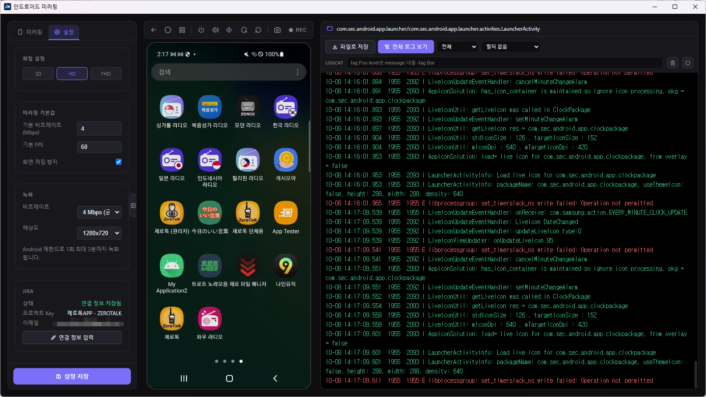

# DroidBridge

Android 기기를 PC 한 창에서 미러링·제어하면서 LogCat 을 보고, 그 자리에서 Jira 백로그까지 올리는 QA 용 데스크탑 앱입니다. (Electron + adb / scrcpy-server)
Windows / macOS / Linux 지원 · iOS 는 기기 정보·로그·화면 캡처까지 ([아래](#ios-제한-지원) 참고)



왼쪽부터 도구 패널(미러링 · 설정 탭) · 기기 화면 · LogCat 입니다.

## 기능

| 기능 | 사용법 | 비고 |
|------|--------|------|
| 화면 미러링·제어 | 가운데 기기 화면을 마우스로 터치·드래그, 키보드로 바로 입력 | 앱 창 안에서 동작 (별도 scrcpy 창 없음). 한글 입력 가능 |
| 기기 버튼 | 화면 위 아이콘 툴바 — 뒤로·홈·최근 앱 / 전원·볼륨 ± | |
| 보기 회전 | 툴바의 좌로 회전 · 우로 회전 | 기기는 그대로 두고 화면만 돌립니다. 세로 고정 앱도 눕혀 볼 수 있습니다 |
| 화면 캡처 | 툴바 카메라 → 미리보기에서 **파일 저장** / **클립보드 복사** | 슬랙 등에 바로 붙여넣기 |
| 화면 녹화 | 툴바 **REC** | MP4, 1회 최대 3분 (Android 제한) |
| APK 설치 | 앱 창 어디에나 `.apk` 를 끌어다 놓기 | 설치 확인 후 설치, 여러 개 한 번에 가능 |
| 파일 전송 | 기기 화면에 파일을 끌어다 놓기 | 기기의 `/sdcard/Download/` 로 들어갑니다 |
| LogCat | 오른쪽 패널 | [아래](#logcat) 참고 |
| 현재 앱 | 미러링 탭 | 포그라운드 앱 표시, 데이터 삭제, 앱 정보, 크래시·ANR 감지 |
| Jira 등록 | 미러링 탭 → **Jira 등록** | 캡처·로그 자동 첨부. [아래](#jira-백로그-등록) 참고 |
| 기기 정보 | 미러링 탭 → 기기 | 모델·Android 버전·전화번호, 복사 버튼 |
| 화질·녹화 설정 | 설정 탭 | SD / HD / FHD, 비트레이트·FPS, 화면 꺼짐 방지 |

## 설치

### Windows

`DroidBridge-Setup-<버전>.exe` 를 실행해 안내대로 설치합니다. 관리자 권한은 필요 없고, 바탕화면과 시작 메뉴에 **안드로이드 미러링** 바로가기가 생깁니다.
adb 가 설치파일에 들어 있어 따로 설치할 것이 없습니다.

> **"Windows의 PC 보호" 창이 뜨면** — 코드 서명을 하지 않은 설치파일이라 그렇습니다. **추가 정보 → 실행** 을 누르면 됩니다.

프로그램은 실행 후 새 버전을 자동 확인합니다. 업데이트가 있으면 다운로드 여부를 묻고, 내려받은 뒤 지금 재시작하거나 앱 종료 시 설치할 수 있습니다. 설정 탭의 **업데이트 확인**으로 수동 확인도 가능합니다. 자동 업데이트는 GitHub Release에 배포된 Windows 버전에서 지원합니다. 자동 업데이트가 없는 기존 설치본은 새 버전 설치파일을 한 번 직접 실행해 업데이트해야 합니다.

### macOS

터미널에 아래 한 줄을 붙여넣으면 받기·열기가 한 번에 됩니다. 열린 창에서 앱을 **응용 프로그램(Applications)** 폴더로 끌어다 놓으면 끝입니다.

```bash
curl -L -o ~/Downloads/DroidBridge.dmg <배포주소> && open ~/Downloads/DroidBridge.dmg
```

`<배포주소>` 는 사내 배포 담당자에게 받으세요. 버전이 올라갈 때마다 파일명이 바뀌므로 README 에 적어두지 않습니다.

macOS 설치본에는 adb 가 들어 있지 않습니다. 한 번 설치해 두세요.

```bash
brew install android-platform-tools
```

> **아키텍처를 맞춰 받아야 합니다.** arm64(Apple Silicon)와 x64(Intel) dmg 가 따로 있고, 잘못 받으면 실행 시 Rosetta 설치 창이 뜹니다. 내 맥 확인: **Apple 메뉴 → 이 Mac에 관하여** 에서 "칩: Apple M…" 이면 arm64, "프로세서: Intel…" 이면 x64. 터미널로는 `uname -m` → `arm64` / `x86_64`.

**반드시 터미널(`curl`)로 받으세요.** 같은 주소라도 Safari·Chrome·Slack·메일로 받으면 macOS 가 파일에 quarantine 플래그를 붙여 게이트키퍼 경고가 뜹니다. `curl`·`scp`·USB·파일서버로 받으면 플래그가 붙지 않아 경고 없이 바로 실행됩니다. 플래그 확인은 `xattr -l ~/Downloads/DroidBridge.dmg` — `com.apple.quarantine` 이 없으면 정상입니다.

### Android 기기 설정 (처음 한 번)

1. 설정 → 휴대전화 정보 → **빌드 번호 7번 탭** → 개발자 모드 활성화
2. 설정 → 개발자 옵션 → **USB 디버깅** 켜기
3. USB 연결 후 폰에 뜨는 "USB 디버깅 허용" 팝업에서 **허용**

앱 왼쪽 아래 **기기 연결** 로 연결합니다.

### iOS (제한 지원)

iPhone 도 연결되지만 **기기 정보 · 로그 · 화면 캡처까지**입니다. 화면 미러링과 터치·키 입력은 지원하지 않아 툴바에는 캡처만 남습니다.

- 로그는 Flutter 앱(`Runner`)의 출력과 크래시 기록만 받습니다. 필터에서 *시스템 로그까지 전부* 로 넓힐 수 있습니다
- 캡처 첫 회는 기기와 연결 통로를 여느라 몇 초 걸리고, 이후엔 1초 안팎입니다
- 준비물
  - macOS: `brew install libimobiledevice`
  - Windows: Apple Devices 앱(또는 iTunes)과 libimobiledevice 도구(`idevice_id.exe` 등)가 필요합니다. **Windows 설치파일에는 libimobiledevice 가 들어 있지 않습니다**

## LogCat

| 하고 싶은 것 | 방법 |
|---|---|
| 지금 앱 로그만 보기 | **현재 실행중인 앱 로그보기** (기본값). 켜져 있으면 버튼이 보라색이 되고 글자가 *전체 로그 보기* 로 바뀝니다 |
| 레벨로 거르기 | 레벨 선택 — 전체 / Debug 이상 / Info 이상 / Warn 이상 / Error 만 |
| 자주 쓰는 묶음 | 필터 선택 — **HTTP 통신**, **예외 · 크래시 · ANR** |
| 직접 검색 | 검색창에 `tag:OkHttp level:E message:"time out" -tag:chatty` 처럼. 항목끼리는 AND, 앞에 `-` 는 제외, 공백 있는 값은 따옴표. `pid:` `tid:` 도 됩니다 |
| 긴 줄 펼쳐 보기 | 200자 넘는 줄을 클릭 → 상세 창. JSON 은 보기 좋게 정리해 보여주고 복사할 수 있습니다 |
| 글자 크기 | LogCat 위에서 **Ctrl + 마우스 휠** |
| 저장 | **파일로 저장** |

- 스크롤을 맨 아래에 두면 새 로그를 따라가고, 위로 올려 두면 그 자리에 멈춰 있습니다.
- 화면에는 **최근 3,000줄**만 남깁니다(오래된 줄부터 지움). 오래 지켜봐야 하면 중간중간 **파일로 저장** 하세요.
- *현재 앱만 보기* 상태에서 앱이 바뀌면 이전 앱 로그는 지워진 게 아니라 **숨겨진 것**입니다. *전체 로그 보기* 로 돌리면 보입니다.

## Jira 백로그 등록

**처음 한 번 — 연결**

1. 설정 탭 → JIRA → **연결 정보 입력**
2. 이메일과 API 토큰 입력 (토큰은 옆의 **토큰 생성 링크 바로가기** 에서 발급) → **연결 테스트**
3. 테스트가 통과하면 프로젝트를 고르고 **저장**

토큰은 OS 암호화 저장소(Windows DPAPI / macOS 키체인)로 암호화해 이 PC 에만 둡니다. 앱을 다시 켜도 연결이 유지됩니다.

**등록**

미러링 탭 → **Jira 등록**. 기기·Android 버전·앱·현재 화면이 채워진 양식(환경 / 재현 절차 / 수정 방향)이 열립니다.

- 이슈 타입, **담당자(필수)**, 제목, 내용을 채우고 등록
- 캡처와 LogCat 로그는 체크하면 파일로 첨부됩니다. 녹화 영상도 첨부할 수 있습니다
- 프로젝트의 추가 필드는 핀으로 고정하면 위에 보이고, 나머지는 접혀 있습니다 (프로젝트별로 기억)
- 팝업이 열려 있는 동안 LogCat 은 멈춥니다 — 닫으면 다시 흐릅니다
- 실수로 닫아도 입력한 내용은 남아 있고, 등록을 마치면 비워집니다
- 토큰이 만료됐으면 등록 창 대신 연결 정보 입력 창이 뜹니다 — 새 토큰을 넣으면 됩니다

## Wi-Fi 연결

1. 먼저 USB 로 한 번 연결한 뒤 터미널에서 `adb tcpip 5555`
   (Windows 설치본의 adb 는 `설치폴더\resources\bin\adb.exe` — 기본 `%LOCALAPPDATA%\Programs\DroidBridge`)
2. USB 를 뽑고 **기기 연결 → Wi-Fi 탭** 에서 폰 IP 입력
   (IP 는 설정 → Wi-Fi → 연결된 네트워크에서 확인)

## 문제 해결

- **원인을 모를 때는 로그부터** — 왼쪽 **미러링 로그** 패널, 또는 파일 `%APPDATA%\droidbridge\mirror.log` (macOS `~/Library/Application Support/droidbridge/mirror.log`). 앱을 켤 때마다 비워지므로 문제가 생긴 직후에 확인하세요.
- **기기가 안 보일 때**: `adb devices` 로 직접 확인. `unauthorized` 면 폰 화면의 "USB 디버깅 허용" 팝업을 확인
- **Windows 에서 adb.exe 실행 오류**: `AdbWinApi.dll`, `AdbWinUsbApi.dll` 이 adb.exe 와 같은 폴더에 있는지 확인
- **로그가 시간이 지나면 사라질 때**: [LogCat](#logcat) 참고 — 3,000줄 제한이거나 현재 앱 필터입니다
- **Jira 연결 테스트가 401 일 때**: 이메일 오타가 가장 흔하고, 그다음이 토큰 만료입니다
- **macOS: 게이트키퍼가 실행을 막을 때**:
  브라우저·Slack·메일로 받으면 quarantine 플래그가 붙어 차단됩니다. 파일이 손상된 것이 아닙니다. 애초에 위 **macOS 설치** 항목처럼 `curl` 로 받으면 이 문제가 생기지 않습니다.
  - *"Apple은 … 악성 코드가 없음을 확인할 수 없습니다"* — `npm run release:mac` 으로 만든 **서명 O / 공증 X** 빌드입니다. **"휴지통으로 이동"을 누르지 마세요.** "완료"를 누른 뒤 **시스템 설정 → 개인정보 보호 및 보안** 에서 아래로 스크롤해 **"그래도 열기"** 를 누릅니다. (macOS 15 부터는 우클릭 → 열기로는 통과되지 않습니다.)
  - *"손상되었기 때문에 열 수 없습니다"* — 서명이 아예 없거나 깨진 빌드입니다(`npm run build:mac`, CI 아티팩트). 이 경우 위 방법으로도 안 되고 아래가 필요합니다.
  - 어느 쪽이든 터미널 한 줄로 해결됩니다. 설치(응용 프로그램 폴더로 드래그) 후:
    ```bash
    xattr -cr /Applications/DroidBridge.app
    ```
  - 경고 자체를 없애려면 배포 담당자가 `npm run notarize:mac` 으로 공증된 빌드를 올려야 합니다.

**알려진 제약**: 클립보드 공유는 양방향 자동 동기화로 바꾸는 중이라 지금은 화면에서 내려가 있습니다. 그 밖의 결함과 미완 작업은 [docs/TODO.md](docs/TODO.md) 에 있습니다.

## 개발

### 소스에서 실행 — 원클릭

**Windows**: 폴더 안의 **`Windows에서_시작.bat`** 을 더블클릭하세요.
Node 확인 → 패키지 설치 → adb 자동 다운로드(`Windows_setup.ps1`) → 기기 확인 → 앱 실행까지 한 번에 됩니다.

**macOS**: **`Mac_Linux에서_시작.command`** 을 더블클릭하세요.
처음엔 "확인되지 않은 개발자" 경고가 뜰 수 있는데, 그럴 땐 파일을 **우클릭 → 열기**를 누르면 됩니다.

**Linux**: 터미널에서
```bash
chmod +x Mac_Linux에서_시작.command   # 최초 1회
./Mac_Linux에서_시작.command
```

> 앱 실행 후에도 빠진 항목이 있으면 **미러링 로그** 패널에 `[세팅]` 줄로 안내되고, 5초마다 다시 확인합니다.

### 소스에서 실행 — 수동

```bash
npm install
```

`bin/` 은 gitignore 대상이라 클론 직후 비어 있습니다. adb 를 채워 주세요.

```bash
# Windows
powershell -ExecutionPolicy Bypass -File ./Windows_setup.ps1

# macOS
brew install android-platform-tools && ln -s "$(which adb)" bin/adb

# Linux
sudo apt install adb && ln -s "$(which adb)" bin/adb
```

미러링에 쓰는 `scrcpy-server` 는 `bin/` 에 없으면 첫 미러링 때 GitHub 에서 자동으로 받습니다(폐쇄망이면 미리 `bin/` 에 넣어 두세요). scrcpy 실행파일은 필요 없습니다.

```bash
npm start        # 일반 실행
npm run dev      # 개발자 도구 포함
npm run check    # 문법 검사 + 자가진단 (커밋 전에)
```

### 배포용 빌드

```bash
npm run build:win     # Windows 설치파일 → dist/DroidBridge-Setup-<버전>.exe
npm run build:mac     # macOS dmg — 미서명, CI 용
npm run release:mac   # macOS dmg — Developer ID 서명 (사내 배포)
npm run notarize:mac  # 위 + Apple 공증 (외부 배포, .notarize.env 필요)
npm run build:linux   # Linux AppImage
```

`bin/` 이 설치파일에 그대로 들어가므로 **Windows 는 `Windows_setup.ps1` 로 채운 뒤 빌드**해야 adb 가 포함됩니다. macOS 는 **`Mac_설치파일_만들기.command`** 더블클릭으로도 dmg 를 만들 수 있습니다. 서명·공증 세부는 [CLAUDE.md](CLAUDE.md) 의 *빌드 / 배포* 항목을 보세요.

Windows 업데이트를 배포하려면 `package.json` 버전을 올리고 `v<버전>` 태그(예: `v1.0.2`)를 푸시합니다. GitHub Actions가 버전과 태그가 일치하는지 확인한 뒤 Windows 설치파일, `latest.yml`, `.blockmap`을 GitHub Release에 게시합니다. 기존 브랜치 빌드와 수동 빌드는 CI artifact만 만들며 자동 업데이트 배포로 취급되지 않습니다.

### 프로젝트 구조

```
android-mirroring/
├── package.json          # Electron 설정 + 빌드 구성
├── bin/                  # adb / scrcpy-server (gitignore — 위 수동 설치로 채움)
├── src/
│   ├── main.js           # 메인 프로세스: adb 호출, IPC 핸들러, 창 관리
│   ├── preload.js        # 렌더러에 노출하는 IPC 브리지 (contextBridge)
│   ├── mirror-bridge.js  # scrcpy-server 구동, 영상·제어 소켓 → 로컬 WebSocket 중계
│   ├── hid-keyboard.js   # UHID 키보드 리포트 (한/영 키 포함)
│   ├── ios-device.js     # iOS 기기·정보·syslog(libimobiledevice), 캡처(go-ios)
│   ├── jira.js           # Jira Cloud REST v2
│   ├── proxy-server.js   # 패킷 분석용 MITM 프록시 (현재 화면에서는 숨김)
│   └── cert-manager.js   # 프록시용 인증서 발급
├── public/
│   ├── index.html        # UI 마크업
│   ├── style.css         # 다크 테마
│   └── renderer.js       # UI 로직 — WebCodecs 디코딩, 입력, LogCat, Jira 팝업
└── docs/                 # TODO.md(알려진 결함), 스크린샷
```

구조와 구현 세부는 [DEVELOPER.md](DEVELOPER.md) 와 [CLAUDE.md](CLAUDE.md) 에 있습니다.
